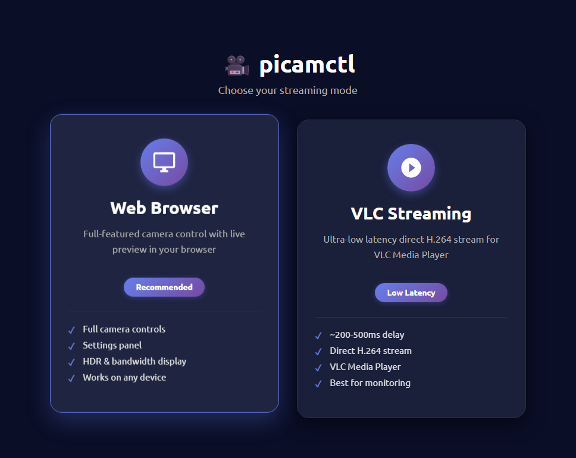
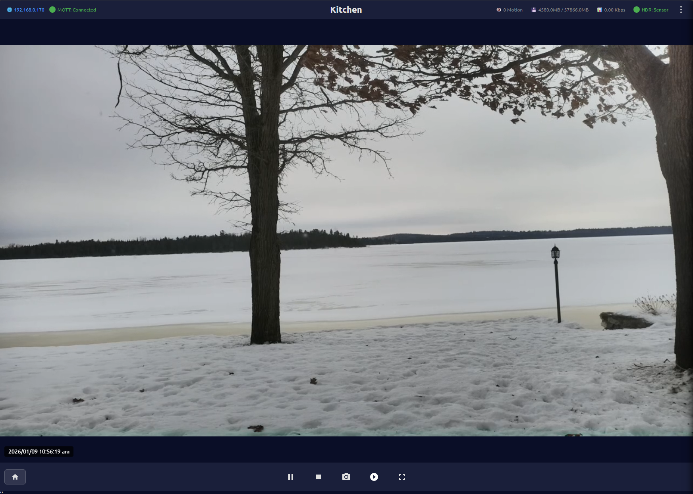
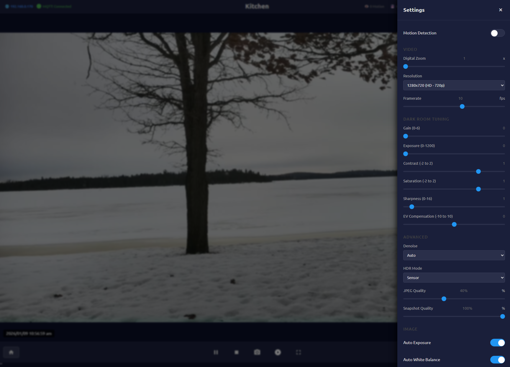

# picamctl - Raspberry Pi Camera Control

A modern web-based camera control interface for Raspberry Pi Camera with dual streaming modes:
- **Web Browser Mode**: Full-featured web UI with HLS streaming
- **VLC Mode**: Low-latency direct H.264 streaming for VLC player



## Features

✅ **Dual Streaming Modes** - Choose between web UI or direct VLC streaming  
✅ **MJPEG Streaming Option** - Optional MJPEG mode for Pi 4/5 (tested on Pi Zero 2 W, planned for Pi 5)  
✅ **H.264 Hardware Acceleration** - Uses rpicam-vid with hardware encoding  
✅ **Modern Dark Theme** - Consistent dark blue UI across all pages  
✅ **Landing Page** - Simple mode selection interface  
✅ **Full Camera Controls** - Resolution, framerate, exposure, white balance, etc.  
✅ **On-Demand Streaming** - Camera runs only while someone is watching (or continuously, your choice)  
✅ **Bitrate Cap** - Automatic by resolution, or a fixed rate per camera  
✅ **MQTT Status Integration** - Real-time connection status with color-coded indicators  
✅ **Systemd Service** - Runs reliably as a background service with auto-start  
✅ **No Zombie Processes** - Proper subprocess management  

### Web Interface


*Main streaming interface with real-time status indicators*


*Comprehensive settings panel with MQTT configuration*

### VLC Streaming Mode


*Direct H.264 streaming setup page*


*Low-latency playback in VLC Media Player*

## Real-World Deployment


*Pi Zero 2 W with Camera Module 3 - Portable surveillance powered by Bluetti battery pack*

**Note:** MJPEG streaming has been tested on Pi Zero 2 W only. Testing on Pi 4/5 is planned. HLS mode is recommended for Pi Zero 2 W due to better CPU efficiency.

## Project Structure

```
raspberry-pi-camera-control/
├── picamctl.py              # Main Flask application
├── templates/               # HTML templates
│   ├── landing.html         # Mode selection page
│   ├── garage_cam_template.html  # Full web UI
│   └── vlc_stream.html      # VLC streaming page
├── static/                  # Favicon
├── scripts/                 # Management scripts
│   ├── check_dependencies.sh    # Check/install dependencies
│   ├── deploy_to_pi.sh         # Deploy to Raspberry Pi
│   ├── manage_service.sh       # Service management (on Pi)
│   ├── start_camera.sh         # Start without systemd (cron @reboot)
│   └── README.md              # Scripts documentation
├── systemd/                 # Systemd service file
│   └── picamctl.service
├── tests/                   # Stream tests, UI tests, fake camera
│   ├── test_stream.py
│   ├── test_ui.py
│   └── fakes/                  # Stand-ins for rpicam-vid / rpicam-still
└── README.md               # This file
```

`picamctl_settings.json` is not in the repository. The app creates it next to `picamctl.py` on the Pi the first time settings are saved, and deploys never overwrite it.

## Quick Start

### 1. Set Environment Variables
```bash
export PI_USER=pi            # Your Pi username
export PI_HOST=your_pi_host  # Pi hostname or IP
```

### 2. Check Dependencies
```bash
./scripts/check_dependencies.sh
```

Installs required packages:
- ffmpeg, rpicam-vid
- Python3, pip3, Flask

### 3. Deploy to Pi
```bash
./scripts/deploy_to_pi.sh
```

The script first checks that the Pi can resolve public DNS names, applies host settings (Wi-Fi power save off, journal size cap, Raspberry Pi Connect disabled), then copies files, installs dependencies and the service, and restarts it. See `scripts/README.md` for the switches.

In the default on-demand mode the camera itself does not start until someone opens the web page.

### 4. Access Interface
Open in your browser:
```
http://<PI_HOST>:5000
```

## Service Management

```bash
# Check status
sudo systemctl status picamctl

# View logs
sudo journalctl -u picamctl -f

# Restart
sudo systemctl restart picamctl

# Stop
sudo systemctl stop picamctl

# Start
sudo systemctl start picamctl
```

## Secret scanning / Pre-commit hooks 🔒
We use `pre-commit` + `detect-secrets` to prevent accidental commits of secrets.

Quick setup for developers:

```bash
# Install tools (do this in your dev environment)
python3 -m pip install --user pre-commit detect-secrets

# Generate baseline (only needed once, review and commit output):
detect-secrets scan > .secrets.baseline

# Install git hooks
pre-commit install
```

The repository includes `.pre-commit-config.yaml` and a `.secrets.baseline` file. If you add a new secret intentionally (e.g. CI helper key), add it to the baseline after review using `detect-secrets audit`.

CI: A GitHub Actions workflow runs `detect-secrets` over every tracked file on pushes and pull requests and fails if it finds a potential secret that is not in `.secrets.baseline`.

## Files

- `picamctl.py` - Main Flask application with H.264 streaming
- `garage_cam_template.html` - Web UI with HLS.js player
- `picamctl_settings.json` - Saved camera settings
- `picamctl.service` - Systemd service file
- `manage_service.sh` - Service management helper
- `deploy_to_pi.sh` - Deployment script
- `check_dependencies.sh` - Dependency checker

## How H.264 HLS Works

1. **rpicam-vid** encodes with the hardware H.264 encoder and writes to stdout:
   - One keyframe per second (`--intra` set to the framerate). HLS can only cut segments at keyframes, so this is what makes 1-second segments possible.
   - Capped bitrate (`--bitrate`), automatic by resolution unless set.
   - stderr goes to `camera.log`.

2. **ffmpeg** reads that stream from a pipe and writes HLS:
   - Copies the H.264 as is (no re-encoding), except for 90°/270° rotation, which is re-encoded in software.
   - Writes 1-second segments to `hls_segments/` and keeps the last 5.
   - Segments are numbered from the clock, so names never repeat across camera restarts.

3. **Flask** serves the files:
   - `/hls/stream.m3u8` - HLS playlist
   - `/hls/segment_<number>.ts` - Video segments
   - While the camera is stopped or starting, the playlist request returns `503` and the player retries.

4. **HLS.js** player in the browser:
   - Plays about 2 segments behind the newest one, so the picture is roughly 3-4 seconds behind live.
   - Reconnects automatically on errors.

In on-demand mode (the default) a playlist request also starts the camera, and it stops again after 60 seconds without stream requests. `/system_info` reports the current `camera_state`: `streaming`, `starting`, `standby`, `error` or `stopped`.

## Camera Settings

Adjust via web interface:
- **Resolution**: 1920x1080 (1080p), 1280x720 (720p), 640x480 (VGA). The dropdown also lists 320x240, which the server does not support and replaces with 640x480.
- **Framerate**: 3-15 fps.
- **Snapshot**: Captures high-quality stills by pausing the stream, then auto-downloads the JPEG. (Exclusive camera access is required.)
- **Brightness**: -1.0 to 1.0
- **Contrast**: -2 to 2
- **Saturation**: -2 to 2
- **Exposure**: Normal, Sport
- **White Balance**: Auto, Daylight, Cloudy, etc.
- **Flip**: Horizontal/Vertical
- **Rotation**: 0°, 90°, 180°, 270°
- **On-Demand** (Streaming section, on by default): the camera starts when someone opens the web page and stops 60 seconds after the last stream request, so nothing is encoded or written to the SD card while nobody is watching. Expect a few seconds' wait for the first picture. Turn it off for continuous streaming.
- **Bitrate** (Streaming section): Auto uses 3 Mbit/s at 720p and 5 Mbit/s at 1080p; pick a fixed value to trade picture detail against network load.

In on-demand standby the MQTT status reports `camera_ready: true` with `camera_state: "standby"`; the metrics topic carries `streaming` (0/1).

## Performance on Pi Zero 2 W

Tested configuration:
- **Hardware**: Pi Zero 2 W (512MB RAM, 4 cores @ 1GHz)
- **Resolution**: 640x480
- **Framerate**: 10 fps
- **Codec**: H.264 (hardware accelerated)
- **CPU Usage**: ~12-15% per process (rpicam-vid + ffmpeg)
- **Memory**: ~50-60MB per process

## Troubleshooting

### No video in browser
In on-demand mode it is normal for there to be no segments and no camera processes while nobody is watching. Open the web page first, then check.

1. Check the camera state (`streaming`, `starting`, `standby`, `error` or `stopped`):
   ```bash
   curl http://<host>:5000/system_info
   ```

2. Check if HLS segments are being created:
   ```bash
   ssh <user>@<host> 'ls -lh /home/<user>/picamctl/hls_segments/'
   ```

3. Check if processes are running:
   ```bash
   ssh <user>@<host> 'ps aux | grep -E "(rpicam-vid|ffmpeg)"'
   ```

4. Check service logs:
   ```bash
   ssh <user>@<host> 'sudo journalctl -u picamctl -f'
   ```

### Zombie processes
Fixed! The new implementation uses:
- `stdout=subprocess.DEVNULL` instead of `PIPE`
- `start_new_session=True` to detach from parent
- Proper process cleanup in stop function

### Stream lag or stalling
- Lower the bitrate (Settings > Streaming). If a 1-second segment takes longer than a second to download, the player falls behind.
- Check the Wi-Fi link under load, not just signal strength: time a segment download from another machine.
- Lower resolution (640x480) or framerate (10 fps)
- Segment length follows the keyframe interval set in `_start_h264_camera()` (one per second)

## Testing

GitHub Actions workflows on pull requests and pushes to `master`:

| Workflow | What it checks | Runs when | Needs a camera? |
|---|---|---|---|
| **Stream Tests** | Segment length, bitrate, on-demand start and idle stop, continuous mode, snapshot, VLC mode | The app, templates, tests or requirements change | No - uses a fake camera |
| **UI Tests** | Page layout, controls, settings panel, API endpoints | The app, templates or tests change | No |
| **Lint** | Shell scripts (shellcheck), Python syntax and undefined names (ruff), JavaScript inside the templates | Always | No |
| **Detect Secrets** | Potential secrets not in `.secrets.baseline` | Always | No |

Stream Tests and UI Tests are path-filtered, so a change to only docs or scripts runs just Lint and Detect Secrets. A fifth workflow, **agent-review**, posts an automated code review as a comment when a pull request is opened or someone comments `/review`; it does not block merging.

### Stream Pipeline Tests

`tests/test_stream.py` runs the real app and the real ffmpeg HLS stage against a stand-in for `rpicam-vid` (`tests/fakes/`) that generates an H.264 test pattern. Needs `ffmpeg` with libx264 and `pytest`:

```bash
pip install -r requirements.txt pytest
pytest -v tests/test_stream.py
```

The run takes a little over a minute. While it runs, the app under test stops camera processes by name (`pkill`), so do not run it on a Pi that is streaming.

### Lint

```bash
shellcheck --severity=warning scripts/*.sh tests/run_tests.sh
ruff check --select E9,F63,F7,F82 picamctl.py scripts tests
node tests/check_template_js.js templates/*.html
```

### UI End-to-End Tests

Comprehensive browser-based UI tests using Playwright to verify all functionality:

#### Quick Start
```bash
cd tests
./run_tests.sh
```

#### Test Coverage
- ✅ Page layout and structure
- ✅ All UI elements (buttons, dropdowns, sliders)
- ✅ Settings panel open/close
- ✅ Camera controls (play/pause, stop, snapshot)
- ✅ Video stream initialization
- ✅ Status indicators (bandwidth, HDR, status circle)
- ✅ Rotation with loading overlay
- ✅ Real-time updates (timestamp, bandwidth)
- ✅ Responsive design (mobile/tablet viewports)
- ✅ API endpoint responses

#### Running Tests

**Basic usage:**
```bash
cd tests
./run_tests.sh
```

**See browser window (headed mode):**
```bash
./run_tests.sh --headed
```

**Quick tests only (skip slow tests):**
```bash
./run_tests.sh --quick
```

**Custom Pi IP address:**
```bash
PI_IP=192.168.1.100 ./run_tests.sh
```

**Verbose output:**
```bash
./run_tests.sh -vv
```

#### Test Reports
After running tests, an HTML report is generated: `tests/test-report.html`

#### Requirements
- Python 3.9+
- Chromium browser (auto-installed by Playwright)
- Camera service running on Pi

Run against a real camera, these tests change its settings (HDR, rotation, bitrate, on-demand) and put them back. In CI they run against the app with no camera attached.

The test script automatically:
1. Creates a virtual environment
2. Installs dependencies (pytest, playwright)
3. Installs Chromium browser
4. Runs all tests against your Pi
5. Generates an HTML report

## Credits

Built for Pi Zero 2 W with Camera 3
Hardware H.264 encoding for efficiency
HLS streaming for compatibility

## License

MIT
