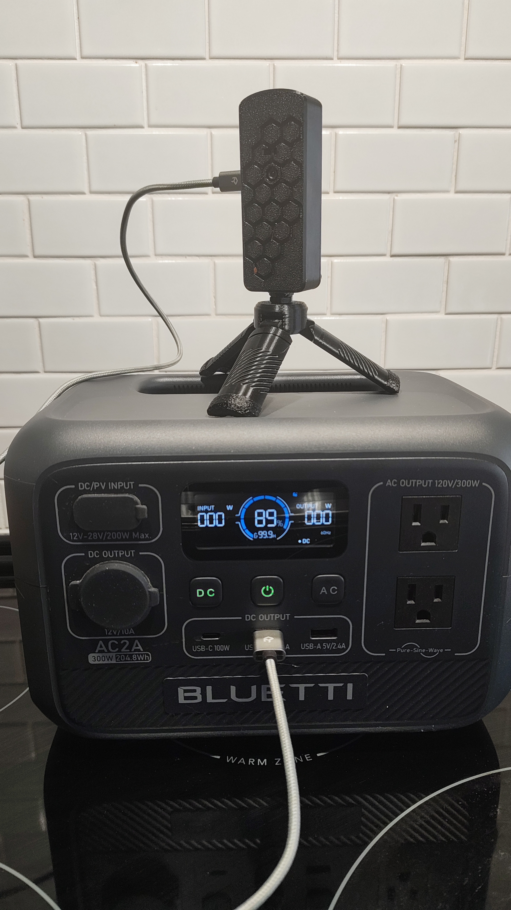

# picamctl - Raspberry Pi Camera Control

A modern web-based camera control interface for Raspberry Pi Camera with dual streaming modes:
- **Web Browser Mode**: Full-featured web UI with HLS streaming
- **VLC Mode**: Low-latency direct H.264 streaming for VLC player


## Features

✅ **Dual Streaming Modes** - Choose between web UI or direct VLC streaming  
✅ **MJPEG Streaming Option** - Optional MJPEG mode for Pi 4/5 (tested on Pi Zero 2 W, planned for Pi 5)  
✅ **H.264 Hardware Acceleration** - Uses rpicam-vid with hardware encoding  
✅ **Modern Dark Theme** - Consistent dark blue UI across all pages  
✅ **Landing Page** - Simple mode selection interface  
✅ **Full Camera Controls** - Resolution, framerate, exposure, white balance, etc.  
✅ **MQTT Status Integration** - Real-time connection status with color-coded indicators  
✅ **Systemd Service** - Runs reliably as a background service with auto-start  
✅ **No Zombie Processes** - Proper subprocess management  

### Web Interface


*Main streaming interface with real-time status indicators*


*Comprehensive settings panel with MQTT configuration*

### VLC Streaming Mode


*Direct H.264 streaming setup page*


*Low-latency playback in VLC Media Player*

## Real-World Deployment


*Pi Zero 2 W with Camera Module 3 - Portable surveillance powered by Bluetti battery pack*

**Note:** MJPEG streaming has been tested on Pi Zero 2 W only. Testing on Pi 4/5 is planned. HLS mode is recommended for Pi Zero 2 W due to better CPU efficiency.

## Project Structure

```
raspberry-pi-camera-control/
├── picamctl.py              # Main Flask application
├── picamctl_settings.json   # Camera settings (auto-generated)
├── templates/               # HTML templates
│   ├── landing.html         # Mode selection page
│   ├── garage_cam_template.html  # Full web UI
│   └── vlc_stream.html      # VLC streaming page
├── scripts/                 # Management scripts
│   ├── check_dependencies.sh    # Check/install dependencies
│   ├── deploy_to_pi.sh         # Deploy to Raspberry Pi
│   ├── manage_service.sh       # Service management (on Pi)
│   └── README.md              # Scripts documentation
├── systemd/                 # Systemd service file
│   └── picamctl.service
└── README.md               # This file
```

## Quick Start

### 1. Set Environment Variables
```bash
export PI_USER=pi            # Your Pi username
export PI_HOST=your_pi_host  # Pi hostname or IP
```

### 2. Check Dependencies
```bash
./scripts/check_dependencies.sh
```

Installs required packages:
- ffmpeg, rpicam-vid
- Python3, pip3, Flask

### 3. Deploy to Pi
```bash
./scripts/deploy_to_pi.sh
```

Copies files, installs service, and starts camera.

### 4. Access Interface
Open browser to `http://pizero2:5000` (or your Pi's IP)
Open in your browser:
```
http://<PI_HOST>:5000
```

## Service Management

## Secret scanning / Pre-commit hooks 🔒
We use `pre-commit` + `detect-secrets` to prevent accidental commits of secrets.

Quick setup for developers:

```bash
# Install tools (do this in your dev environment)
python3 -m pip install --user pre-commit detect-secrets

# Generate baseline (only needed once, review and commit output):
detect-secrets scan > .secrets.baseline

# Install git hooks
pre-commit install
```

The repository includes `.pre-commit-config.yaml` and a `.secrets.baseline` file. If you add a new secret intentionally (e.g. CI helper key), add it to the baseline after review using `detect-secrets audit`.

CI: A GitHub Actions workflow runs `detect-secrets` on pushes and pull requests and will fail the check if new potential secrets are detected that are not present in `.secrets.baseline`.


```bash
# Check status
sudo systemctl status picamctl

# View logs
sudo journalctl -u picamctl -f

# Restart
sudo systemctl restart picamctl

# Stop
sudo systemctl stop picamctl

# Start
sudo systemctl start picamctl
```

## Files

- `picamctl.py` - Main Flask application with H.264 streaming
- `garage_cam_template.html` - Web UI with HLS.js player
- `picamctl_settings.json` - Saved camera settings
- `picamctl.service` - Systemd service file
- `manage_service.sh` - Service management helper
- `deploy_to_pi.sh` - Deployment script
- `check_dependencies.sh` - Dependency checker

## How H.264 HLS Works

### Problem with Previous Approach
- Using `PIPE` for stdout/stderr caused zombie (defunct) processes
- libav HLS encoding was unreliable in systemd context

### Solution
1. **rpicam-vid** with TCP output:
   - Uses `--codec h264` for hardware encoding
   - Outputs to `tcp://0.0.0.0:8888`
   - Uses `DEVNULL` for stdout (no blocking)
   - Logs stderr to file

2. **ffmpeg** as HLS converter:
   - Connects to TCP stream from rpicam-vid
   - Copies H.264 (no re-encoding)
   - Generates HLS segments in `/hls_segments/`
   - Auto-deletes old segments (keeps last 10)

3. **Flask** serves HLS files:
   - `/hls/stream.m3u8` - HLS playlist
   - `/hls/segment_XXX.ts` - Video segments

4. **HLS.js** player in browser:
   - Plays HLS in any browser
   - Adaptive bitrate support
   - Auto-reconnect on errors

## Camera Settings

Adjust via web interface:
- **Resolution**: 1920x1080 (1080p), 1280x720 (720p), 640x480 (VGA), 320x240 (QVGA). Note: higher resolutions may be unstable on Pi Zero 2 W — use lower resolutions for reliability.
- **Framerate**: 3-120 fps (higher framerates available at lower resolutions). For Pi Zero 2 W we recommend **5–15 fps** for stable streaming.
- **Snapshot**: Captures high-quality stills by pausing the stream, then auto-downloads the JPEG. (Exclusive camera access is required.)
- **Brightness**: -1.0 to 1.0
- **Contrast**: 0 to 2.0
- **Saturation**: 0 to 2.0
- **Exposure**: Normal, Sport
- **White Balance**: Auto, Daylight, Cloudy, etc.
- **Flip**: Horizontal/Vertical
- **Rotation**: 0°, 90°, 180°, 270°
- **On-Demand** (Streaming section, on by default): the camera starts when someone opens the web page and stops 60 seconds after the last stream request, so nothing is encoded or written to the SD card while nobody is watching. Expect a few seconds' wait for the first picture. Turn it off for continuous streaming.
- **Bitrate** (Streaming section): Auto uses 3 Mbit/s at 720p and 5 Mbit/s at 1080p; pick a fixed value to trade picture detail against network load.

In on-demand standby the MQTT status reports `camera_ready: true` with `camera_state: "standby"`; the metrics topic carries `streaming` (0/1).

## Performance on Pi Zero 2 W

Tested configuration:
- **Hardware**: Pi Zero 2 W (512MB RAM, 4 cores @ 1GHz)
- **Resolution**: 640x480
- **Framerate**: 10 fps
- **Codec**: H.264 (hardware accelerated)
- **CPU Usage**: ~12-15% per process (rpicam-vid + ffmpeg)
- **Memory**: ~50-60MB per process

## Troubleshooting

### No video in browser
1. Check if HLS segments are being created:
   ```bash
   ssh <user>@<host> 'ls -lh /home/<user>/picamctl/hls_segments/'
   ```

2. Check if processes are running:
   ```bash
   ssh <user>@<host> 'ps aux | grep -E "(rpicam-vid|ffmpeg)"'

3. Check service logs:
   ```bash
   ssh <user>@<host> 'sudo journalctl -u picamctl -f'
   ```

### Zombie processes
Fixed! The new implementation uses:
- `stdout=subprocess.DEVNULL` instead of `PIPE`
- `start_new_session=True` to detach from parent
- Proper process cleanup in stop function

### Stream lag
- Lower resolution (640x480)
- Reduce framerate (10 fps)
- Segment length follows the keyframe interval set in `_start_h264_camera()` (one per second)

## Testing

Three GitHub Actions workflows run on pull requests and pushes to `master`:

| Workflow | What it checks | Needs a camera? |
|---|---|---|
| **Stream Tests** | Segment length, bitrate, on-demand start and idle stop, continuous mode, snapshot, VLC mode | No - uses a fake camera |
| **UI Tests** | Page layout, controls, settings panel, API endpoints | No |
| **Lint** | Shell scripts (shellcheck), Python syntax and undefined names (ruff), JavaScript inside the templates | No |

### Stream Pipeline Tests

`tests/test_stream.py` runs the real app and the real ffmpeg HLS stage against a stand-in for `rpicam-vid` (`tests/fakes/`) that generates an H.264 test pattern. Needs `ffmpeg` with libx264 and `pytest`:

```bash
pip install -r requirements.txt pytest
pytest -v tests/test_stream.py
```

The run takes a little over a minute. While it runs, the app under test stops camera processes by name (`pkill`), so do not run it on a Pi that is streaming.

### Lint

```bash
shellcheck --severity=warning scripts/*.sh tests/run_tests.sh
ruff check --select E9,F63,F7,F82 picamctl.py scripts tests
node tests/check_template_js.js templates/*.html
```

### UI End-to-End Tests

Comprehensive browser-based UI tests using Playwright to verify all functionality:

#### Quick Start
```bash
cd tests
./run_tests.sh
```

#### Test Coverage
- ✅ Page layout and structure
- ✅ All UI elements (buttons, dropdowns, sliders)
- ✅ Settings panel open/close
- ✅ Camera controls (play/pause, stop, snapshot)
- ✅ Video stream initialization
- ✅ Status indicators (bandwidth, HDR, status circle)
- ✅ Rotation with loading overlay
- ✅ Real-time updates (timestamp, bandwidth)
- ✅ Responsive design (mobile/tablet viewports)
- ✅ API endpoint responses

#### Running Tests

**Basic usage:**
```bash
cd tests
./run_tests.sh
```

**See browser window (headed mode):**
```bash
./run_tests.sh --headed
```

**Quick tests only (skip slow tests):**
```bash
./run_tests.sh --quick
```

**Custom Pi IP address:**
```bash
PI_IP=192.168.1.100 ./run_tests.sh
```

**Verbose output:**
```bash
./run_tests.sh -vv
```

#### Test Reports
After running tests, an HTML report is generated: `tests/test-report.html`

#### Requirements
- Python 3.9+
- Chromium browser (auto-installed by Playwright)
- Camera service running on Pi

The test script automatically:
1. Creates a virtual environment
2. Installs dependencies (pytest, playwright)
3. Installs Chromium browser
4. Runs all tests against your Pi
5. Generates an HTML report

## Credits

Built for Pi Zero 2 W with Camera 3
Hardware H.264 encoding for efficiency
HLS streaming for compatibility

## License

MIT
